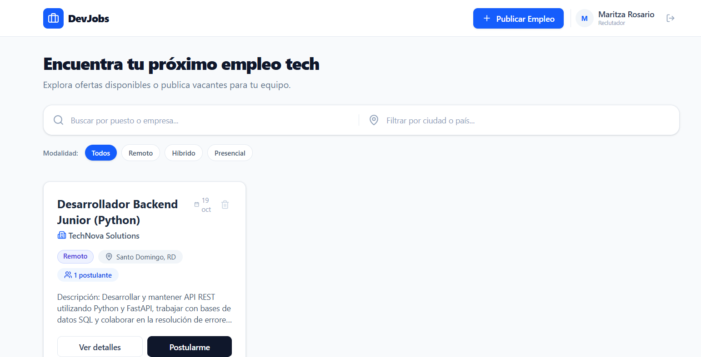
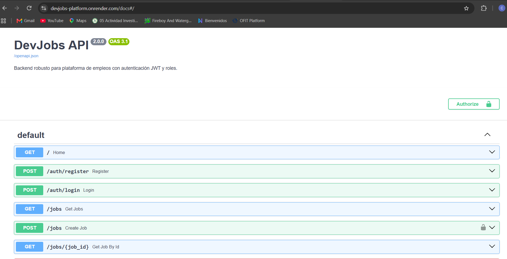
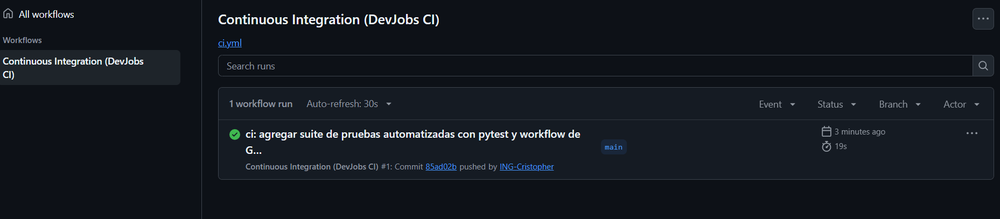

<div align="center">

# 💼 DevJobs Platform

**Plataforma Fullstack de Empleo Tech con Autenticación JWT y Pipeline CI/CD Automatizado**

[](https://github.com/ING-Cristopher/plataforma-empleos/actions/workflows/ci.yml)
[](https://devjobs-platform.vercel.app/)
[](https://devjobs-platform.onrender.com/docs)
[](https://fastapi.tiangolo.com/)
[](https://react.dev/)

[🚀 Probar Demo en Vivo](https://devjobs-platform.vercel.app/) • [📖 Documentación Swagger](https://devjobs-platform.onrender.com/docs)

</div>

---

## 🌟 Vista General del Proyecto

DevJobs es una solución web para conectar talento tecnológico con empresas reclutadoras. Construida bajo una arquitectura desacoplada y orientada a servicios, cuenta con control de acceso basado en roles (RBAC), filtros reactivos en tiempo real y pruebas automatizadas en la nube.

<div align="center">
  
</div>

---

## ✨ Características Clave

- **Control de Acceso por Roles (RBAC):**
  - **Reclutador:** Publica y elimina ofertas, visualiza candidatos postulados en tiempo real.
  - **Candidato / Visitante:** Explora vacantes, filtra por modalidad y envía su postulación.
- **Seguridad Criptográfica:** Hashing directo con `bcrypt` (mitigación de límites de 72 bytes) y sesiones sin estado con tokens Bearer JWT.
- **Navegación SPA:** Páginas dedicadas (`/jobs/:id`) construidas con React Router DOM y función para copiar enlaces directos al portapapeles.
- **Filtros Dinámicos:** Búsqueda combinada por palabras clave, localización y etiquetas de modalidad (*Remoto*, *Híbrido*, *Presencial*).

---

## 📸 Arquitectura y Producción

<table width="100%">
  <tr>
    <td width="50%" align="center">
      <b>API REST Documentada (FastAPI + Swagger)</b>
    </td>
    <td width="50%" align="center">
      <b>Pipeline de CI Automatizado (GitHub Actions)</b>
    </td>
  </tr>
  <tr>
    <td>
      
    </td>
    <td>
      
    </td>
  </tr>
  <tr>
    <td>Endpoints protegidos con Bearer Auth desplegados en Render.</td>
    <td>Pruebas unitarias/integración con <code>pytest</code> y compilación con Vite en 19 segundos.</td>
  </tr>
</table>

---

## 🛠️ Tecnologías Utilizadas

| Capa | Herramientas |
| :--- | :--- |
| **Frontend** | React 18, Vite, Tailwind CSS, Lucide React, React Router DOM |
| **Backend** | Python 3.12+, FastAPI, SQLAlchemy ORM, SQLite / PostgreSQL ready |
| **Seguridad** | PyJWT, Bcrypt, OAuth2 Password Bearer |
| **Testing** | Pytest, HTTPX, FastAPI TestClient |
| **CI / CD** | GitHub Actions (Ubuntu Runners), Vercel (Frontend), Render (API) |

---

## 🚀 Instalación y Puesta en Marcha Local

### 1. Clonar el repositorio
```bash
git clone [https://github.com/ING-Cristopher/plataforma-empleos.git](https://github.com/ING-Cristopher/plataforma-empleos.git)
cd plataforma-empleos
2. Backend (FastAPI)
Bash
cd backend
python -m venv .venv

# Activar en Windows PowerShell:
.venv\Scripts\Activate.ps1

# Instalar dependencias y correr pruebas
pip install -r requirements.txt
python -m pytest

# Iniciar servidor
python -m uvicorn main:app --reload
API local: http://127.0.0.1:8000 | Swagger: http://127.0.0.1:8000/docs

3. Frontend (React + Vite)
En una nueva terminal:

Bash
cd frontend
npm install
npm run dev
Aplicación web local: http://localhost:5173

🔧 Variables de Entorno
Backend (backend/.env o variables en Render)
Fragmento de código
JWT_SECRET_KEY=tu_clave_secreta_para_firmar_jwt
Frontend (frontend/.env o variables en Vercel)
Fragmento de código
VITE_API_URL=[https://devjobs-platform.onrender.com](https://devjobs-platform.onrender.com)